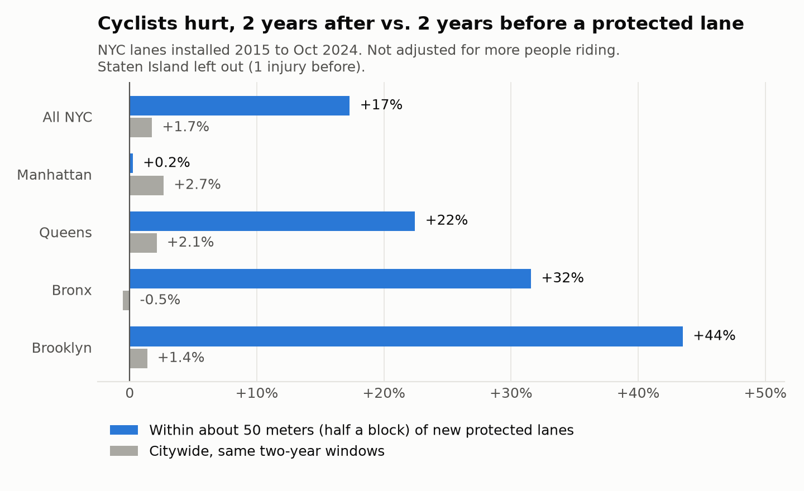
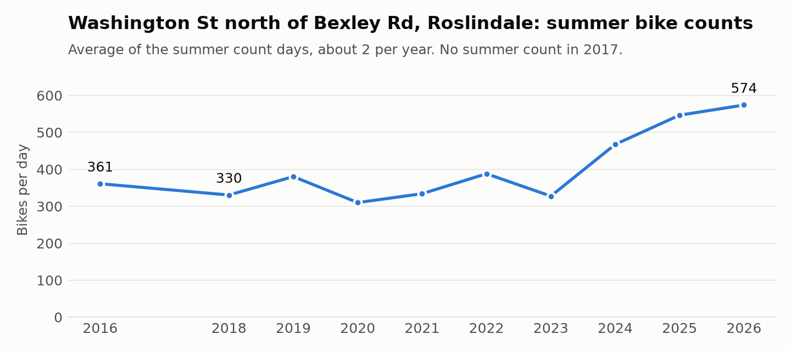
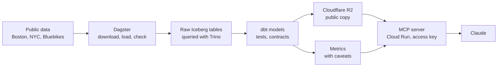

# bike-lane-lakehouse

Boston and New York City bike, traffic, and crash data in Apache Iceberg tables, modeled with dbt, scheduled with Dagster, and queried with Trino or by an AI client through MCP.

> **Try it:** email hattawaya@gmail.com for an access key, [connect Claude Code or the free MCP Inspector](#use-the-public-server), and ask, for example, *"How have summer bike counts on Washington St in Roslindale changed since 2018?"* Or, with no key, [browse the tables on Hugging Face](#no-setup-browse-it-on-hugging-face).

I live near Hyde Park Ave in Roslindale, which has no bike lane; the City is [looking at a redesign](https://www.boston.gov/departments/transportation/project/hyde-park-avenue-multimodal-corridor). New York publishes when every bike lane went in, so it's a good place to see what changes after one does.

**Bottom line**

- **Riding near me is up.** Summer bike counts on Washington St in Roslindale went from about 330 a day in 2018 to 574 in 2026, while car traffic stayed flat. Each summer is only two count days, so treat the size of the jump as rough.
- **The NYC data can't show whether protected lanes make streets safer.** Cyclists hurt within about 50 meters (half a block) of new lanes rose 17%, against 1.7% citywide, but lanes go where riding is growing and there's no per-street ridership count to adjust for it.
- **Putting the caveats in the metrics made AI answers more honest.** Asked through MCP, a small model gave the right number and the right caveat 29 of 30 times using the metrics, and 26 of 30 writing its own SQL. A large model got all 30 either way ([eval](evals/RESULTS.md)).

**See it work.** A real Claude Code session connected to the public server (sped up 1.5×). Claude calls bikelake three times: it lists the metrics to learn their names and caveats, queries the lane metrics for all of NYC to get the headline number, then queries them again by borough to check whether the citywide rise holds everywhere (it doesn't; Manhattan is flat). It answers with the numbers and the caveats that come with the metrics. Claude picks the calls itself, so another question, or the same one asked again, can take more or fewer.






## How it works



Everything runs in Docker on a laptop. For the public copy, GitHub Actions runs the same steps every morning and publishes the clean tables to Cloudflare R2, where the server on Cloud Run reads them.

## Stack

| Piece | Where | What it does |
|---|---|---|
| RustFS | [`docker-compose.yml`](docker-compose.yml) | S3-compatible storage. `landing` holds files as downloaded; `warehouse` holds Iceberg tables |
| Iceberg REST catalog | [`catalog/`](catalog/) | Tracks each table's current metadata. Keeps its pointers in Postgres |
| Trino | [`trino/catalog/`](trino/catalog/) | Queries Iceberg and Postgres |
| Loaders | [`src/bikelake/`](src/bikelake/) | Download each source, load it into `iceberg.raw` |
| dbt | [`dbt/`](dbt/) | Staging, intermediate, and mart models; tests; contracts; metrics with caveats |
| Dagster | [`src/bikelake/defs.py`](src/bikelake/defs.py) | Loads, dbt models, schedules, and checks in one asset graph |
| MCP server | [`src/bikelake/mcp_server.py`](src/bikelake/mcp_server.py) | Metrics and read-only SQL for AI clients |
| Eval | [`evals/`](evals/) | Accuracy of semantic-layer queries vs. plain text-to-SQL |
| Approved knowledge | [`knowledge/`](knowledge/) | Owner-approved definitions for an agent; catches fact changes, stale copies on other pages, and metrics out of sync |
| Cloudflare R2 | [`src/bikelake/publish.py`](src/bikelake/publish.py) | Public copy of the mart tables, in Cloudflare's Iceberg catalog |
| Cloud Run | [`cloudrun/`](cloudrun/) | Public MCP server: Trino reading R2 with a read-only key, behind an access key |
| GitHub Actions | [`.github/workflows/refresh.yml`](.github/workflows/refresh.yml) | Runs the Dagster job daily and republishes to R2 |

Conventions and commands: [CLAUDE.md](CLAUDE.md). Why it's built this way: [docs/decisions/](docs/decisions/).

## Run it

Needs Docker.

```bash
git clone https://github.com/amanda-nathan/bike-lane-lakehouse
cd bike-lane-lakehouse
cp .env.example .env          # replace each change-me, e.g. with: openssl rand -hex 16
docker compose up -d --build
```

Then open Dagster, go to **Catalog**, select all assets, and click **Materialize**. It takes about 10 minutes, mostly the NYC crash file.

| | |
|---|---|
| Dagster | http://localhost:3000 |
| MCP server | http://localhost:8000/mcp |
| Jupyter | http://localhost:8888 |
| Trino | http://localhost:8080, or `docker compose exec trino trino` |
| Storage console | http://localhost:9001/rustfs/console/ |

Everything is reachable only from your own computer (ports are bound to 127.0.0.1). To ask questions of your local copy from Claude Code, run: `claude mcp add --transport http bikelake http://localhost:8000/mcp`

## How the public data stays current

Every day at 6:30 am Eastern, GitHub Actions starts a temporary lakehouse on its runner, runs the same Dagster job as the local stack (download every source, load, `dbt build` with tests, publish), and shuts down. The public server reads R2 directly, so new data shows up without a redeploy. It's free: GitHub doesn't charge public repos for Actions minutes.

To refresh now: **Actions > Refresh public data > Run workflow** on GitHub, or `gh workflow run refresh.yml`. From the local stack, materialize `public/marts` in Dagster.

NYC Open Data sometimes turns away anonymous downloads from GitHub's machines with a 503. The loads retry, and if it keeps happening, a free NYC Open Data app token saved as the `SOCRATA_APP_TOKEN` repository secret lifts the limit.

## Use the public server

A public copy of the MCP server runs on Google Cloud Run and reads the mart tables from Cloudflare R2 with a read-only key. Every request needs an access key: email me at hattawaya@gmail.com for one. Opening the URL in a browser shows "Missing or wrong access key"; that's expected.

URL: `https://bikelake-mcp-140130294299.us-east1.run.app/mcp` (Cloud Run gives each service an address like this: the service name, the Google Cloud project number, and the region)

Three ways to use it:

| | Cost to you | What you get |
|---|---|---|
| [Claude Code](#claude-code) | Needs a paid Claude plan | Ask questions in plain English; Claude picks the tools and explains the answer |
| [LibreChat](docs/librechat/README.md) | Free app; you pay for the model (Claude Haiku: under a cent a question) or run a free one locally | Ask in plain English in an open-source chat app you run yourself, with the model you choose |
| [MCP Inspector](docs/inspector/README.md) | Free | No AI: run the same tools yourself and see exactly what they return |

The first request after the server has been idle can take 20 seconds to a minute while Trino starts.

### Claude Code

1. Add the server:
   ```bash
   claude mcp add --scope user --transport http bikelake \
     https://bikelake-mcp-140130294299.us-east1.run.app/mcp \
     --header "Authorization: Bearer ACCESS_KEY"
   ```
2. Start `claude`. `/mcp` should show bikelake as connected.
3. Ask, and allow the bikelake tools when asked. For example:
   - *Using bikelake, how have summer bike counts on Washington St in Roslindale changed since 2018?*
   - *Using bikelake, did new protected bike lanes in NYC make streets more dangerous for cyclists?*

To remove it later: `claude mcp remove bikelake -s user`. The Claude desktop and web apps can add it as a custom connector with the same header; that hasn't been tested here.

### Example

Asked in Claude Code, connected to the public server on Cloud Run (November 2026):

> Using bikelake, how have summer bike counts on Washington St in Roslindale changed since 2018?

Claude looked up the location, queried the summer metric, then checked the individual count days. Its answer, shortened:

| Summer | Bikes/day | Count days | Bike share of traffic |
|---|---|---|---|
| 2018 | 331 | 2 | 1.9% |
| 2023 | 328 | 2 | 1.9% |
| 2024 | 468 | 2 | 2.7% |
| 2025 | 547 | 2 | 3.2% |
| 2026 | 574 | 2 | 3.5% |

> Flat from 2018 to 2023, then a step up from 2024. Every count day since 2024 (458–593 bikes) is higher than every count day from 2018 to 2023. Car traffic stayed around 16,000–17,000 a day, so the share rose because there were more bikes.
>
> Caveats: each summer is 2 count days, so one day moves the average a lot. One 2018 day was rainy; using only the dry day, the increase is about 58%, not 74%. "Summer" means weekdays in early June. The data can't say why counts rose.

### LibreChat

[LibreChat](docs/librechat/README.md) is a free, open-source chat app you run in Docker. You add the server once in its config file, each person types their own access key into the app, and then you ask questions in plain English with Claude or another model. Setup, the config, and screenshots of every step: [docs/librechat/README.md](docs/librechat/README.md).

### Free alternative: MCP Inspector

The [MCP Inspector](docs/inspector/README.md) is a free tool for trying the server in your browser, with no AI and no paid plan. It doesn't answer questions in plain English the way Claude does. Instead it shows exactly what Claude is given: the four tools, the rows, the SQL the semantic layer wrote, and each metric's caveats. It's also a quick way to check the numbers behind an answer, or to watch `run_sql` refuse a `DELETE`. Steps, screenshots, and a video: [docs/inspector/README.md](docs/inspector/README.md).

### No setup: browse it on Hugging Face

The tables are also a free public [Hugging Face dataset](https://huggingface.co/datasets/AmandaHattaway/bike-lane-lakehouse), with a **SQL Console** that runs DuckDB in your browser, and a small [Bike Lane Explorer](https://huggingface.co/spaces/AmandaHattaway/bike-lane-explorer) page with charts and a SQL box. No access key, no AI. Bluebikes trips aren't included: their license doesn't allow republishing the data as a stand-alone dataset. How they're built: [huggingface/README.md](huggingface/README.md).

How it's deployed and run: [cloudrun/README.md](cloudrun/README.md).

## Eval

Claude answered questions through the MCP server with SQL tools only, and with the metrics preferred. On hard questions, Opus 5.5 got every answer right either way. Haiku 5.5 got 26 of 30 with SQL only and 29 of 30 with the metrics, mostly because the metric's caveats came along. Two answers I first marked wrong turned out to be better than my answer key. Details and cost: [evals/RESULTS.md](evals/RESULTS.md).

## Data

| Table | Source | Rows |
|---|---|---|
| `raw.boston_bike_counts_daily` | [Boston BTD](https://data.boston.gov/dataset/streets-daily-bike-counts) | ~3K |
| `raw.boston_bike_counts_hourly` | [Boston BTD](https://data.boston.gov/dataset/streets-hourly-bike-counts) | ~138K |
| `raw.boston_crashes` | [Boston Vision Zero](https://data.boston.gov/dataset/vision-zero-crash-records) | ~43K |
| `raw.bluebikes_trips` | [Bluebikes](https://bluebikes.com/system-data), latest 12 months | ~4.6M |
| `raw.nyc_bike_routes` | [NYC DOT](https://data.cityofnewyork.us/d/mzxg-pwib) | ~30K |
| `raw.nyc_crashes` | [NYPD](https://data.cityofnewyork.us/d/h9gi-nx95) | ~2.3M |

Quirks the staging models handle: Boston count times are UTC, Bluebikes times are local; trips across the November clock change end before they start; a few rows are duplicated at the source; NYC route records are versioned. About 29% of NYC crashes have no borough.

Local Dagster schedules (off until turned on): NYC crashes daily, the other sources weekly, Bluebikes monthly, station status hourly. Each one rebuilds only the models downstream of its source and republishes to R2. The public data is refreshed by GitHub Actions either way.

## Not built yet

- A mart with one row per crash near a new lane. Today a crash near two adjacent lane segments is counted once for each; the eval found it ([details](evals/RESULTS.md#what-it-showed))
- Larger tables: NYC traffic speeds and Citi Bike trips
- Incremental loads for NYC crashes, instead of a full reload
- Compaction and snapshot expiry for the local tables (Cloudflare does both for the public copy)
- Trino access control and column masking
- CI that runs the tests on pull requests
- [`space/`](space/) is a Hugging Face Space version of the public server. It wasn't deployed: Hugging Face now requires a PRO subscription to run Docker Spaces on free hardware. The tables are on Hugging Face instead as a [dataset and a static page](huggingface/README.md).
