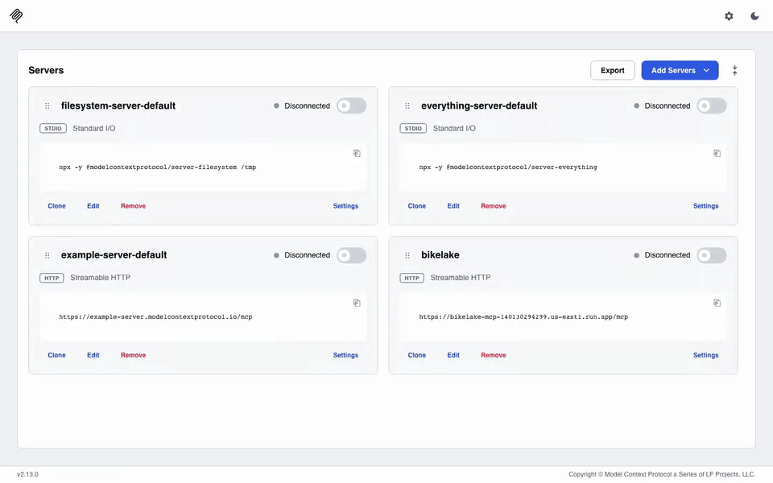
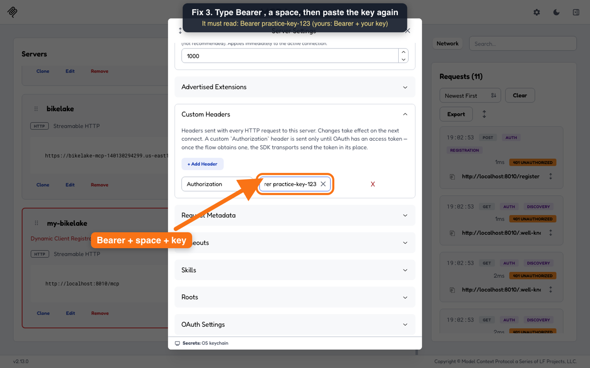
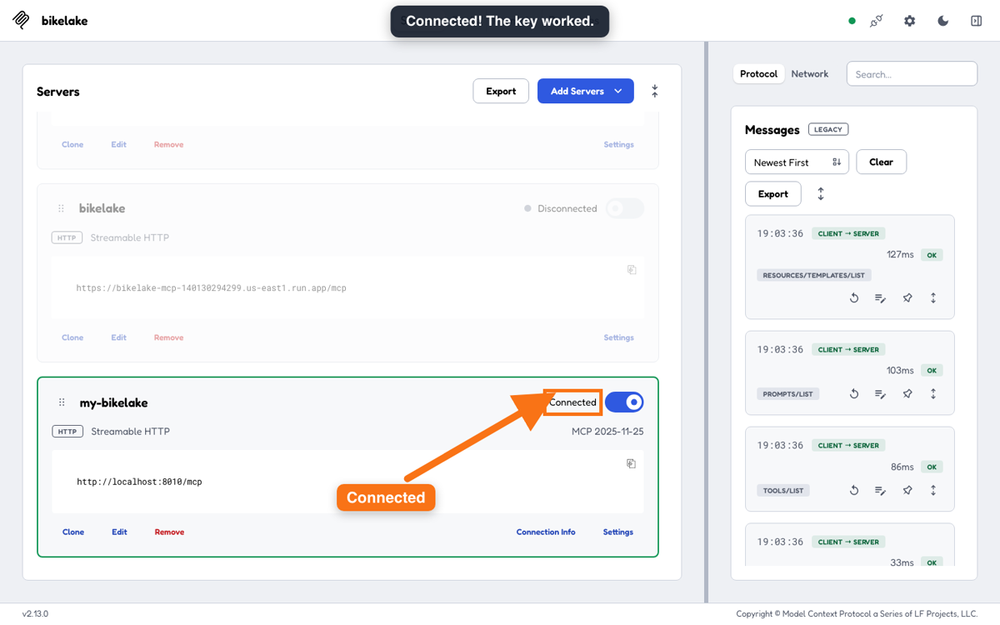

# Use the public server with the MCP Inspector (free)

The [MCP Inspector](https://github.com/modelcontextprotocol/inspector) is a free, open-source tool for trying MCP servers in your browser. It has no AI: you pick a tool, fill in its inputs, and see exactly what comes back.

## Why use it instead of Claude

It isn't a replacement for asking Claude questions in plain English (that's in the [main README](../../README.md#use-the-public-server)). It's useful when you want to:

- **Try the server without a paid AI plan.** The Inspector and Node.js are free.
- **See exactly what an AI is given.** The same four tools Claude uses, and their raw results: the rows, the SQL the semantic layer wrote, and each metric's caveats.
- **Check the numbers yourself.** Run the SQL behind an AI's answer and compare.
- **Test the guardrails.** Try a `DELETE` or a query on a raw table and watch `run_sql` refuse it.

## Setup

Needs [Node.js](https://nodejs.org) and an access key (email hattawaya@gmail.com).



This recording uses a local copy of the server, so no access key is on screen. For the public server, use the URL `https://bikelake-mcp-140130294299.us-east1.run.app/mcp` and the header `Authorization: Bearer <your access key>` (step 3).

1. Run `npx @modelcontextprotocol/inspector`. It opens in your browser.
2. **Add Servers > Add manually**, choose **streamable-http**, and paste the server URL: `https://bikelake-mcp-140130294299.us-east1.run.app/mcp`
3. On the new server's card, click **Settings > Custom Headers > + Add Header**. Key: `Authorization`. Value: `Bearer`, a space, then the access key you were sent. Close the window; it saves by itself.

   

   If it says "Missing or wrong access key", the value is usually missing `Bearer ` in front. Step-by-step video with the fix: [how-to-add-your-access-key.mp4](how-to-add-your-access-key.mp4) (a practice server and key, no real key shown).
4. Flip the server's switch. It should say **Connected**. The first request after the server has been idle can take 20 seconds to a minute.

   
5. Open **Tools** at the top, pick **run_sql**, paste a query, and click **Execute Tool**:
   ```sql
   SELECT count_year, round(avg(bikes)) AS bikes_per_day, count(*) AS count_days
   FROM fct_boston_bike_counts_daily
   WHERE location_name = 'Washington Street north of Bexley Road' AND season = 'Summer'
   GROUP BY count_year ORDER BY count_year
   ```
   Or pick **query_metrics** with metrics `["new_lane_injury_change", "citywide_injury_change"]` and group_by `["lane_segment__borough"]` to get a metric with its caveats.

## The four tools

| Tool | What it returns |
|---|---|
| `list_metrics` | Every metric, its description, caveats, and the dimensions it can be grouped by |
| `query_metrics` | Metric values, the SQL the semantic layer wrote, and the caveats |
| `describe_tables` | The queryable tables, columns, and descriptions |
| `run_sql` | Results of one read-only SELECT on `iceberg.marts` (up to 1,000 rows); anything else is refused |
