# Use the public server from LibreChat

[LibreChat](https://www.librechat.ai) is a free, open-source chat app you run yourself ([GitHub](https://github.com/danny-avila/LibreChat), MIT license). You pick the model (Claude, OpenAI, or a free model on your own computer), add the bikelake server, and ask questions in plain English, like in Claude Code. Boston University's TerrierGPT is built on LibreChat.

Tested November 7, 2026 with LibreChat v0.8.9-rc1 and Claude Haiku 5.5. Each person enters their own access key in the app, so no key goes in a config file.

[← Back to the README](../../README.md#use-the-public-server)

## What you need

- Docker
- An access key for the bikelake server (email hattawaya@gmail.com)
- A model. These steps use Claude Haiku 5.5 with an Anthropic API key; a question costs well under a cent. LibreChat can also use a free model on your computer through [Ollama](https://ollama.com), but small models are less reliable at using the tools.

## Set up LibreChat (once)

```bash
git clone https://github.com/danny-avila/LibreChat
cd LibreChat
cp .env.example .env
cp docker-compose.override.yml.example docker-compose.override.yml
```

1. **In `.env`**, fill in the blank secrets. Each needs a random value; generate one per line with `openssl rand -hex 32` (`openssl rand -hex 16` for `CREDS_IV`): `CREDS_KEY`, `CREDS_IV`, `JWT_SECRET`, `JWT_REFRESH_SECRET`, `MEILI_MASTER_KEY`. Then set:
   ```bash
   ANTHROPIC_API_KEY=your-anthropic-key
   ALLOW_UNVERIFIED_EMAIL_LOGIN=true   # no email server needed to sign up
   ```
2. **In `docker-compose.override.yml`**, uncomment the lines that mount `librechat.yaml` into the `api` service.
3. **Create `librechat.yaml`:**
   ```yaml
   version: 1.3.18
   cache: true

   mcpServers:
     bikelake-public:
       type: streamable-http
       url: https://bikelake-mcp-140130294299.us-east1.run.app/mcp
       # The server takes a plain access key, not a sign-in. Without this line,
       # LibreChat sees the "key required" reply and asks you to sign in instead.
       requiresOAuth: false
       headers:
         Authorization: "Bearer {{BIKELAKE_ACCESS_KEY}}"
       customUserVars:
         BIKELAKE_ACCESS_KEY:
           title: "bikelake access key"
           description: "The access key you got by email"
       timeout: 120000
   ```
   `{{BIKELAKE_ACCESS_KEY}}` is filled in with the key each person types into the app (step 3 below).
4. Start it: `docker compose up -d`. Open http://localhost:3080 and click **Sign up**. The account is stored only on your computer.

## Use it

**1. Pick the model.** Click the model name at the top, hover over **Anthropic**, and click **claude-haiku-5-5**.

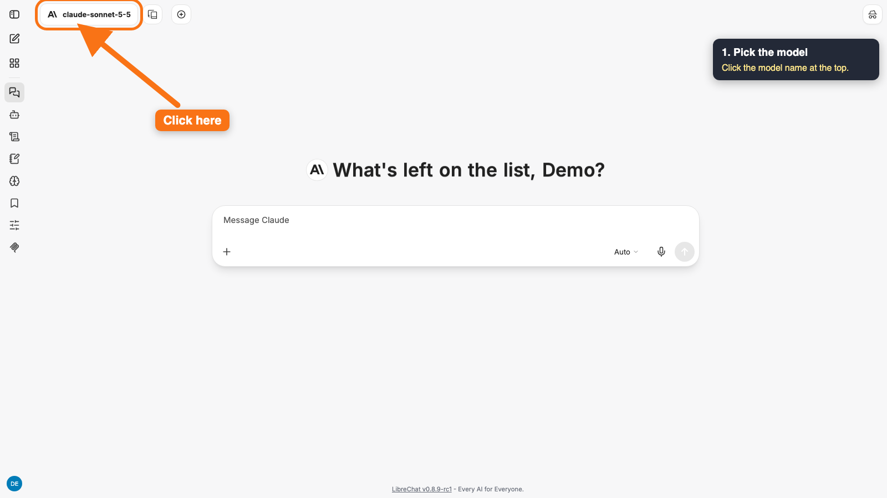
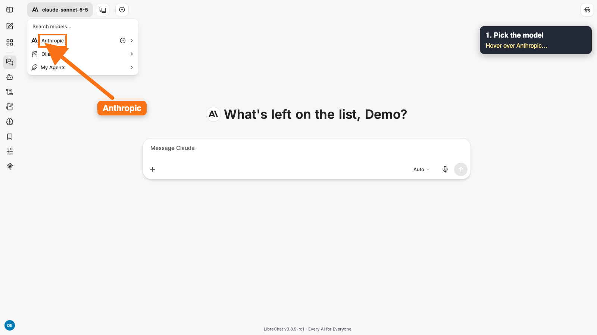
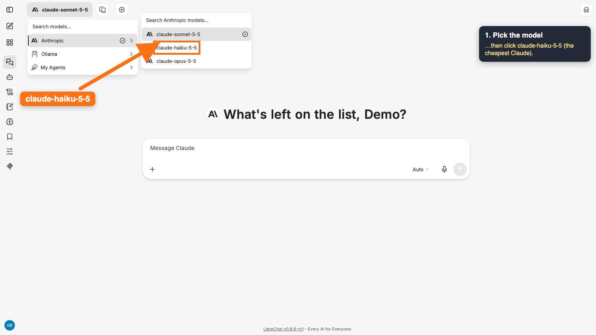

**2. Add the bikelake server.** Click **+** under the message box, type "public", and click **bikelake-public**.

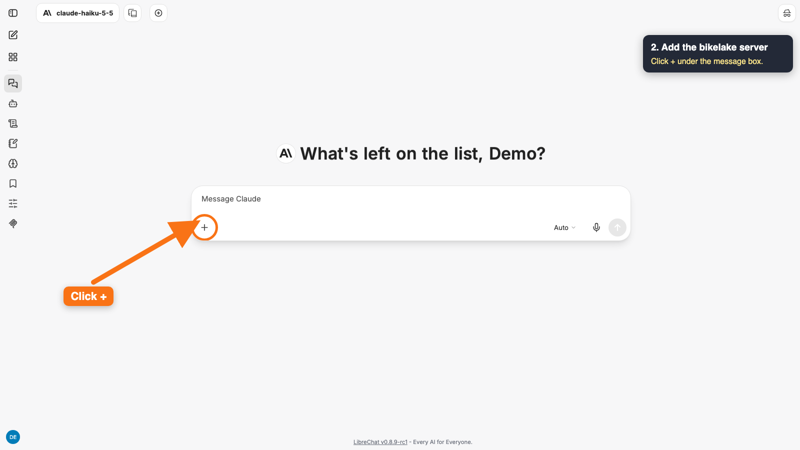
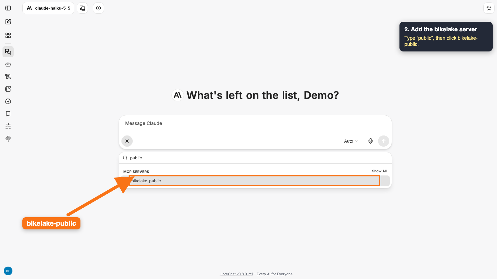

**3. Enter your access key.** LibreChat asks once. Paste the key you got by email (it stays hidden), then click **Save**.

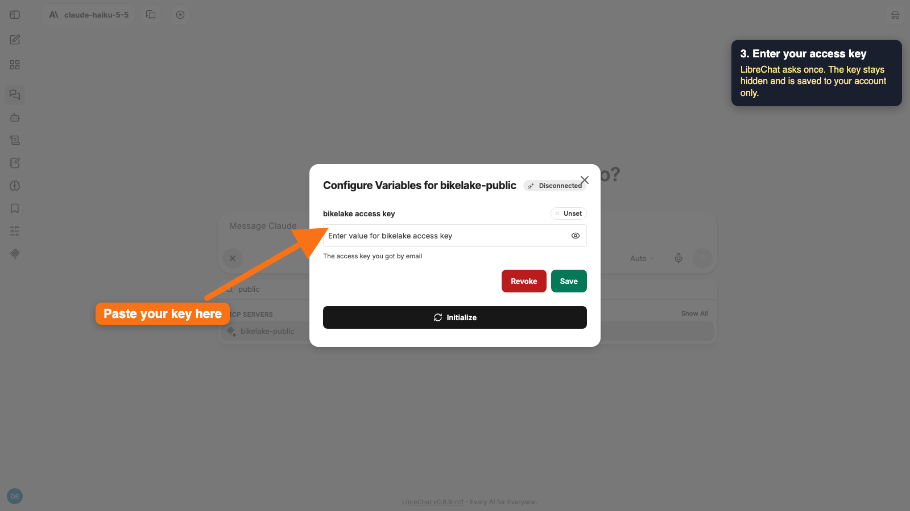
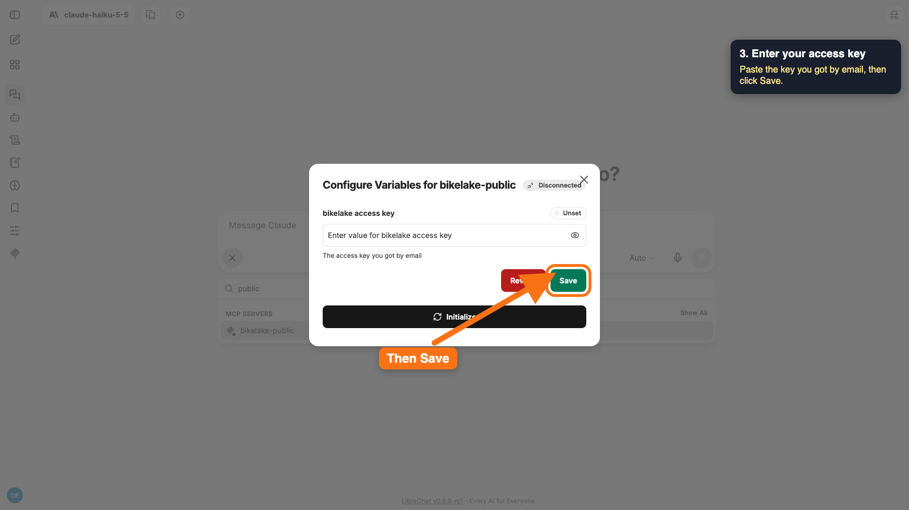

**4. Connect.** Click **Initialize**. **Active** means the server accepted your key.

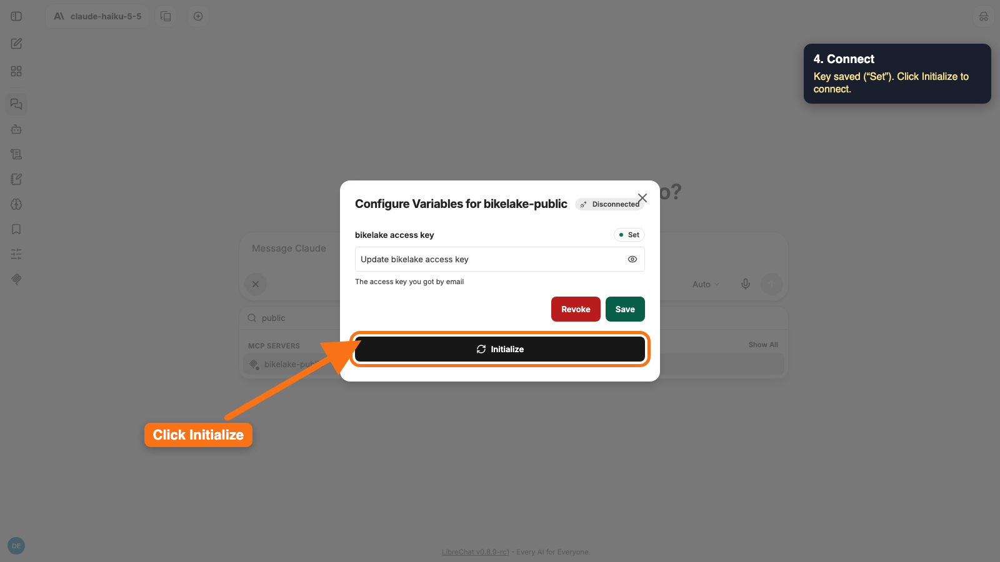
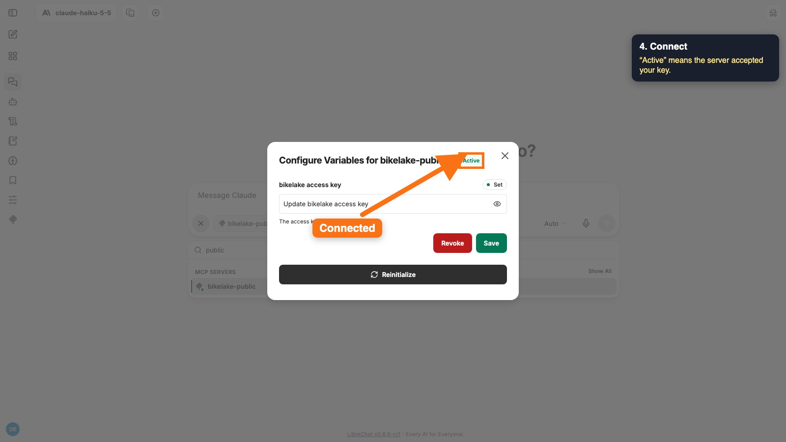

**5. Check it's on.** The **bikelake-public** badge under the message box means the model can use the server's tools. Saving the key turns it on; if the badge isn't there, click **+** and **bikelake-public** again.

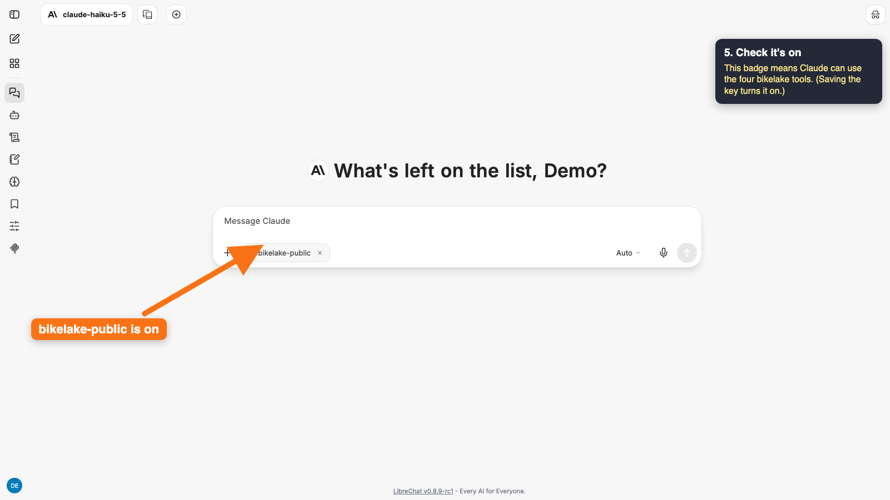

**6. Ask.** Start with "Using bikelake-public" so the model knows to use it.

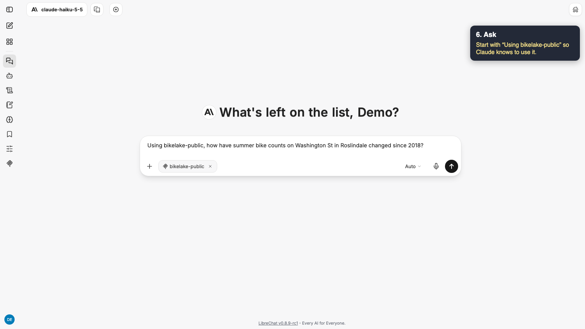

**7. The answer.** "Ran 4 actions · bikelake-public" means Claude called the server four times. The numbers come from the server, with the caveats that come with the metrics.

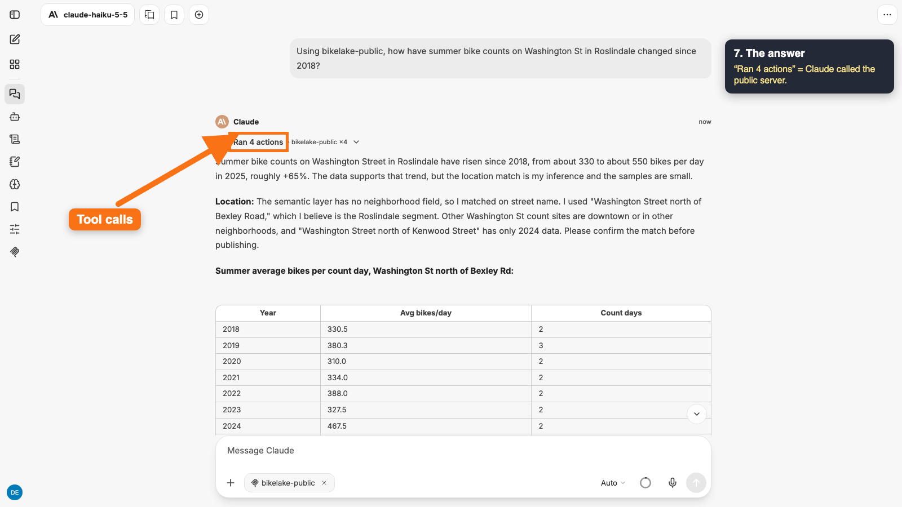
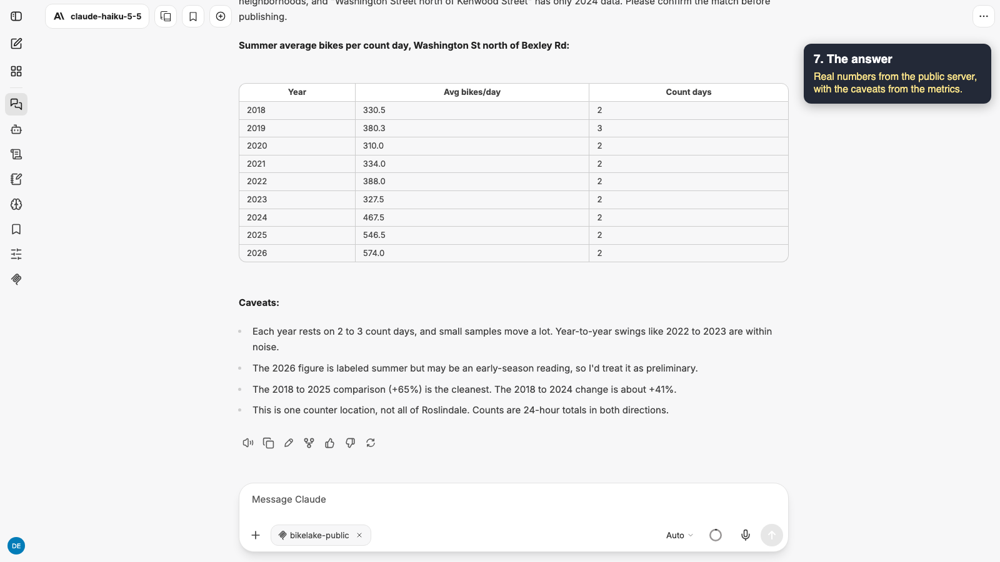

The first question after the server has been idle can take 20 seconds to a minute while it starts.

## If something's wrong

| What you see | Fix |
|---|---|
| A "Needs Auth" label and an **Authenticate** button instead of a key box | Add `requiresOAuth: false` to the server in `librechat.yaml` and restart: `docker compose restart api` |
| The model says it can't access bikelake-public | The badge isn't on. Click **+** and **bikelake-public** |
| The server stays "Disconnected" after **Initialize** | Check the key for extra spaces, then **Save** and **Initialize** again |

## Related

- [MCP Inspector](../inspector/README.md): the same tools with no AI, free, for seeing exactly what the server returns
- [How it's deployed](../../cloudrun/README.md)
