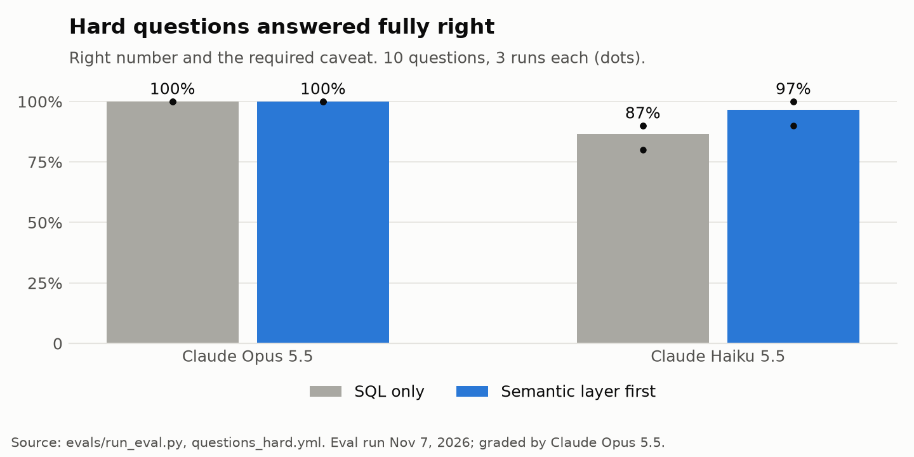
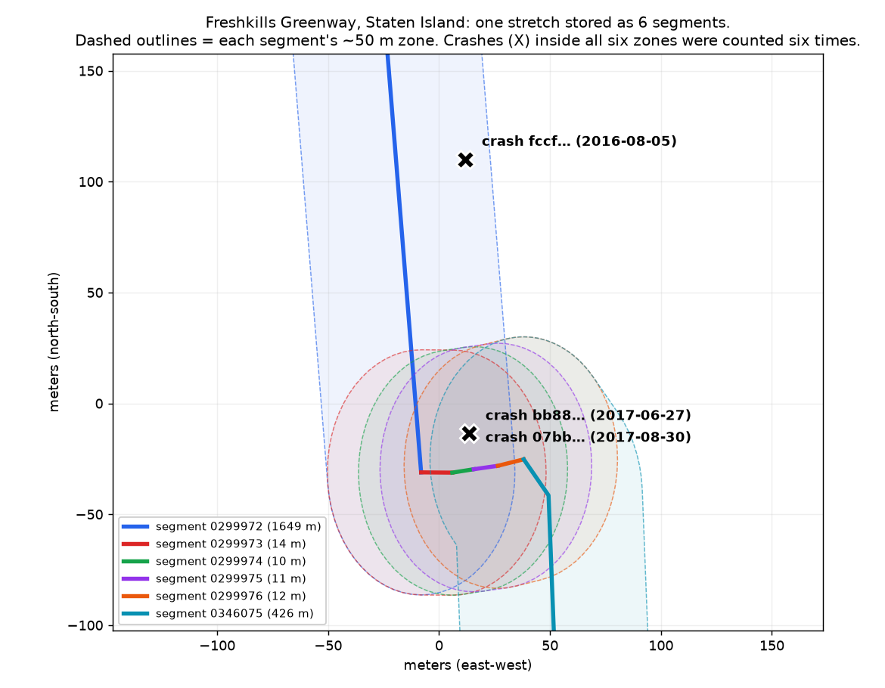

# Eval results



Claude answered each question through the MCP server two ways: with SQL tools only, or with the dbt metrics preferred. An answer counts as right when its number matches the reference SQL and it makes the caveat the question needs. Claude Opus 5.5 grades the caveat.

| Model | Questions | Runs | SQL only | Semantic layer first |
|---|---|---|---|---|
| Opus 5.5 | 20 easy | 1 | 20/20 | 20/20 |
| Opus 5.5 | 10 hard | 3 | 30/30 | 30/30 |
| Haiku 5.5 | 10 hard | 3 | 26/30 | 29/30 |
| Haiku 5.5 | 20 easy | 3 | 56/60 | 57/60 |

Haiku's misses on the easy set are rounding (0.4 for 0.404).

## What it showed

- **Opus got everything right either way.** With documented tables, the semantic layer didn't change its accuracy.
- **Haiku is where the semantic layer helped.** Asked whether new lanes make streets more dangerous, SQL-only Haiku never mentioned that more people ride after a lane opens, in 3 of 3 runs. With the metric, that caveat came along.
- **The eval checked my answer key too, and twice the AI was right where my key was wrong.** An answer key is just my own best answer, so it can be wrong. When an answer didn't match, I read it before marking it wrong:
  1. **Washington St growth, 2018 to 2025.** My key compared summer with summer: +65%. One answer compared summer and fall together, the only seasons counted in both years: +97%. That's also a fair comparison, so it's now an accepted answer.
  2. **Staten Island lanes.** My key used the totals in [`fct_nyc_new_lane_safety`](../dbt/models/marts/fct_nyc_new_lane_safety.sql): 1 cyclist hurt before the new lanes and 13 after, +1,200%. One answer noticed the same crashes showing up more than once, counted each crash once, and got 1 before and 3 after, +200%. It was right: my mart counts a crash once for every lane segment it's near, and one stretch of path there is six segments ([the SQL behind it](#the-double-count-in-the-sql)). Its answer is now accepted, and fixing the mart is the first item under [Next](#next).

  After both changes I re-graded the saved answers against the corrected key (`--regrade`, no new AI calls).

The hard questions are in [questions_hard.yml](questions_hard.yml). Each one has a trap: a partial year, mixed seasons, two locations with the same street name, a 12-month data window, or numbers too small to mean anything.

### The double count, in the SQL

The join in [`int_nyc__cyclist_crashes_near_new_lanes.sql`, lines 35–37](../dbt/models/intermediate/int_nyc__cyclist_crashes_near_new_lanes.sql#L35-L37) draws a zone of about 50 m around each new lane segment and keeps every cyclist crash inside it:

```sql
from lanes
join crashes
    on st_contains(lanes.zone, crashes.location)
```

That makes one row per segment and crash pair. A lane can be stored as several segments, so a crash near one stretch of lane matches every segment of it. On Staten Island, Freshkills Greenway from Richmond Hill Rd to Arthur Kill Rd is six segments, and two crashes near it each matched all six:

| Crash (ID shortened) | Date | Period | Rows in the join |
|---|---|---|---|
| `07bb4a0b…` | 2017-08-30 | after | 6 (segments 0299972–0299976 and 0346075) |
| `bb88365b…` | 2017-06-27 | after | 6 (the same six) |
| `fccfabf9…` | 2016-08-05 | after | 1 |
| `cf2fd4e2…` | 2023-08-02 | before | 1 (Goethals Road North) |



*Four of the six segments are 10–14 m scraps at a bend. The two crashes there are 16–27 m from all six segments, so they fall inside every zone.*

Each segment's own count is right: those crashes really were near every one of the six. The trouble starts when segments are added together. [`fct_nyc_new_lane_safety`](../dbt/models/marts/fct_nyc_new_lane_safety.sql#L11-L19) totals each segment, and the lane metrics add those totals across a borough or the whole city, so 3 crashes after became 6 + 6 + 1 = 13, and the change looked like +1,200% instead of +200%.

Counting each crash once, as the agent did and as the accepted answer in [questions_hard.yml](questions_hard.yml) now does:

```sql
SELECT count(DISTINCT CASE WHEN period = 'after' THEN collision_id END) AS crashes_after,
       count(DISTINCT CASE WHEN period = 'before' THEN collision_id END) AS crashes_before
FROM iceberg.intermediate.int_nyc__cyclist_crashes_near_new_lanes c
JOIN iceberg.marts.dim_nyc_protected_lanes l ON l.segment_id = c.segment_id
WHERE l.borough = 'Staten Island'
```

`DISTINCT` works for one borough, but the real fix belongs in the model: a crash can be "before" one segment and "after" a neighbor installed later, so a crash-level table needs a rule for which lane each crash belongs to. That's the first item under [Next](#next).

## Cost

| Run | Answers | Cost |
|---|---|---|
| Opus, easy | 40 | $4.14 |
| Opus, hard | 60 | $7.69 |
| Haiku, hard | 60 | $0.48 |
| Haiku, easy | 120 | $0.29 |
| Smoke tests | 6 | $0.42 |
| **Total** | **286** | **$13.02** |

Includes grading. Priced at list rates ($4 / $20 per million input / output tokens for Opus 5.5, $0.10 / $0.50 for Haiku 5.5). Paid from the monthly API credits included with a Claude Max plan.

## Running it

```bash
uv run --group eval python evals/run_eval.py --dry-run                                   # expected answers, free
uv run --group eval python evals/run_eval.py --questions questions_hard.yml --repeats 3  # about $8 on Opus
uv run --group eval python evals/run_eval.py --model claude-haiku-5-5                    # about $0.10
uv run --group eval python evals/run_eval.py --regrade evals/results/<file>.json         # after changing the key
uv run --group docs python docs/charts.py                                                # redraw the chart
```

Needs `ANTHROPIC_API_KEY` in `.env` and the stack running. Raw answers and grades are in [results/](results/).

## Next

- **Fix the double count** in [`fct_nyc_new_lane_safety`](../dbt/models/marts/fct_nyc_new_lane_safety.sql). The crash-to-lane join in [`int_nyc__cyclist_crashes_near_new_lanes`](../dbt/models/intermediate/int_nyc__cyclist_crashes_near_new_lanes.sql) matches a crash to every lane segment within about 50 m, so a crash near two adjacent segments is counted twice ([see the SQL](#the-double-count-in-the-sql)). The eval found it (see [What it showed](#what-it-showed)): Claude recounted Staten Island by distinct crash and got 3 after vs. 1 before, not 13 vs. 1. The fix is a mart with one row per crash near a new lane, so totals count each crash once. Until then, the lane metrics carry it as a caveat in [`_semantic.yml`](../dbt/models/marts/_semantic.yml).
- Spot-check the model grader against my own reading of a sample of answers.
- Questions with no single right number, where the right answer is "the data can't say".
