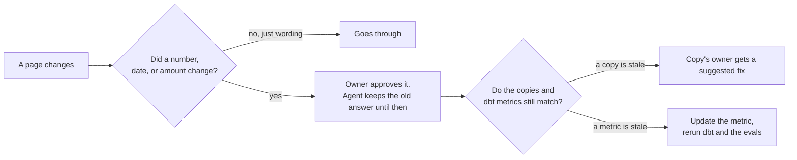
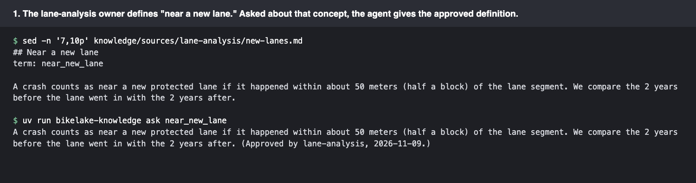
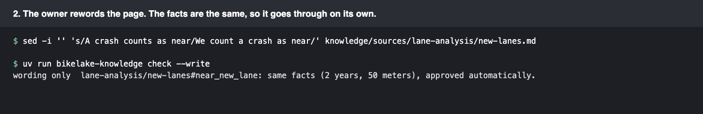
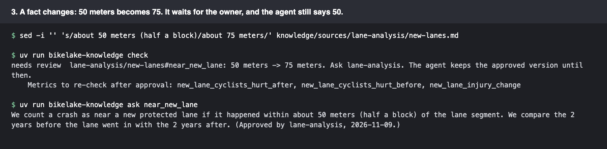
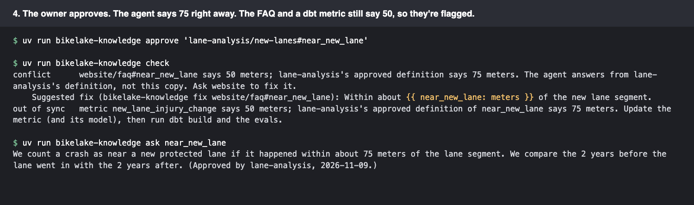
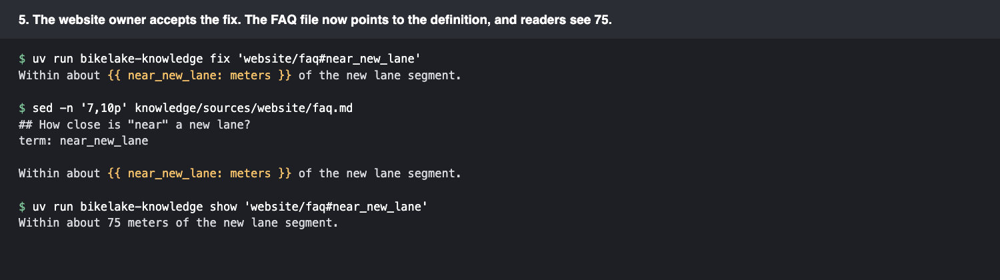
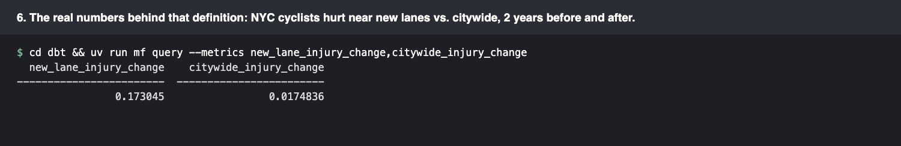

# Approved knowledge

If an AI agent answers people's questions, it should only say things the people who own that information have signed off on. And when someone changes a page, I want to know whether the change actually matters before I bother anyone about it.

This folder is a small working example of that, using the definitions behind my bike data.

**What's real and what's made up:** the definitions and numbers are real. They come from this project's dbt models and metric caveats, like "near a new lane means within about 50 meters." The owners are made up. `lane-analysis`, `count-analysis`, `trip-analysis`, and `website` stand in for the offices that would own pages in a real organization; in this project they're all me. The change from 50 meters to 75 below never happened. It's there to show what the check does.

## How it's set up

- Each folder in `sources/` belongs to one owner, and each `## ` section of a page is one concept. The `term:` line names the concept, using the ID from [`glossary.yml`](glossary.yml). `near_new_lane`, for example, means "what counts as near a new bike lane."
- The glossary says who owns each concept. The owner's section is the definition. If another page mentions the same concept, it's a copy.
- [`approved.yml`](approved.yml) holds what each owner approved. The agent only answers from the owners' approved sections.

## What happens when a page changes



The check saves a hash of each approved section and pulls out its facts: numbers with units, dollar amounts, months, and years. If the text changes but the facts don't, it's just rewording, and nobody needs to look at it. If a fact changes, the owner has to approve it first.

I don't rewrite a copy on someone else's page, because that page is theirs. The check suggests a fix that swaps the copied number for a placeholder, `{{ near_new_lane: meters }}`, which means "fill in the meters from the approved definition of near_new_lane." It works like `{{ ref('...') }}` in dbt. Once the owner accepts the fix, their page keeps up on its own.

The dbt metrics list the concepts they depend on in `config.meta.glossary_terms` (in [`_semantic.yml`](../dbt/models/marts/_semantic.yml)). So when a definition changes, the check also tells me which metrics to update.

## Walking through it

These are real runs. `ask` shows what the agent would say about a concept: it looks up the concept's approved definition. A real agent would first match a question like "how close counts as near a lane?" to the concept, then answer from that definition.













To run it yourself:

```bash
uv run bikelake-knowledge check             # exits 1 if a person needs to look at something
uv run bikelake-knowledge ask near_new_lane # what the agent would say
uv run bikelake-knowledge demo              # the same walk-through, in a temporary copy
```

The same check runs in a [GitHub Action](../.github/workflows/knowledge.yml) whenever a page or a metric changes.

## What it doesn't do

- It finds facts by pattern, so it misses facts written out in words, like "half a block" or "fifty meters." A language model could pull out facts instead, but that costs money on every change.
- It only compares sections tagged with the same concept. A page that repeats a definition without the tag gets missed. Embedding search could help find those.
- It checks what a metric's description says, not its SQL. The real lane query uses a 0.0005-degree buffer ([the model](../dbt/models/intermediate/int_nyc__cyclist_crashes_near_new_lanes.sql)), and changing to 75 meters would mean changing that too.
- `ask` takes a concept ID, not a question in plain words. Matching questions to concepts is the agent's job.
- Approving is a command here. In a real setup, the owner would approve a pull request, with a CODEOWNERS entry for each owner's folder.
