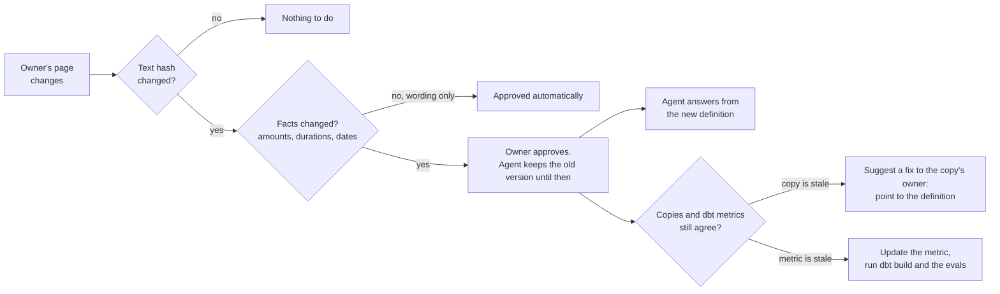

# Approved knowledge

An AI agent should answer only from knowledge its owners have approved, and the knowledge should stay correct as pages change. This folder is a small working version of that loop, using this project's own bike data definitions.

Each page belongs to an owner (here `nyc-safety`, `boston-counts`, `bluebikes`, and `public-site`, standing in for the offices that would own pages in a real organization). Pages are split by concept, not by page: each `## ` section is one concept, tagged with a term from [`glossary.yml`](glossary.yml). The glossary names one owner per concept. That owner's approved section is the **definition**, and it's the only thing the agent answers from. Any other page that mentions the concept is a **copy**.

A copy can either repeat a fact ("within about 50 meters"), which the check compares with the definition, or **point to it**: `{{ near_new_lane: meters }}` is filled in from the approved definition, so it changes when the definition does and can't go stale.



| File | What it is |
|---|---|
| [`sources/<owner>/*.md`](sources/) | The live pages, one folder per owner |
| [`glossary.yml`](glossary.yml) | Every concept and who owns it |
| [`approved.yml`](approved.yml) | The approved version of each section, with its facts and a hash. The agent answers only from this |
| [`src/bikelake/knowledge.py`](../src/bikelake/knowledge.py) | The check, approvals, fixes, and the agent's lookup |
| [`.github/workflows/knowledge.yml`](../.github/workflows/knowledge.yml) | Runs the check on every change to a page or a metric |

## What the check catches

| Finding | When | Who's asked |
|---|---|---|
| wording only | The text changed, the facts didn't | No one; saved as approved with `check --write` |
| needs review | A fact changed, e.g. 50 meters became 75 | The page's owner. The agent keeps the approved version until then. Lists the dbt metrics linked to the concept |
| conflict | A copy states a fact the definition doesn't | The copy's owner, with a suggested fix. The agent keeps answering from the definition; it never uses the copy |
| out of sync | A dbt metric's description or caveats disagree with the definition | The metric's owner. Then run dbt build and the evals |
| broken reference | A `{{ term: kind }}` doesn't match exactly one approved fact | The page's owner |
| new, removed, unknown term | A section was added or deleted, or uses a term not in the glossary | The page's owner |

The glossary term is what connects the knowledge to the semantic layer: metrics in [`_semantic.yml`](../dbt/models/marts/_semantic.yml) list the concepts they depend on in `config.meta.glossary_terms`, so a change to a definition flags both the copies that repeat it and the metrics built on it.

## Try it

```bash
uv run bikelake-knowledge check            # report; exits 1 if anything needs a person
uv run bikelake-knowledge ask near_new_lane
uv run bikelake-knowledge show 'public-site/faq#bluebikes_window'
uv run bikelake-knowledge demo             # the walk-through below, in a temporary copy
```

`demo` makes the changes in a temporary copy, so the real files don't change. Its output, shortened:

```
=== 1. nyc-safety rewords its page. The facts stay the same.

wording only  nyc-safety/new-lanes#near_new_lane: same facts (2 years, 50 meters), approved automatically.

=== 2. nyc-safety changes 50 meters to 75 meters

needs review  nyc-safety/new-lanes#near_new_lane: 50 meters -> 75 meters. Ask nyc-safety. The agent keeps the approved version until then.
    Metrics to re-check after approval: new_lane_cyclists_hurt_after, new_lane_cyclists_hurt_before, new_lane_injury_change

agent, asked about near_new_lane:
  We count a crash as near a new protected lane when it's within about 50 meters (half a block) of the lane segment. ...

=== 3. nyc-safety approves. The agent says 75; the FAQ copy and the dbt metric still say 50.

conflict      public-site/faq#near_new_lane says 50 meters; nyc-safety's approved definition says 75 meters. The agent answers from nyc-safety's definition, not this copy. Ask public-site to fix it.
    Suggested fix (bikelake-knowledge fix public-site/faq#near_new_lane): Within about {{ near_new_lane: meters }} of the new lane segment.
out of sync   metric new_lane_injury_change says 50 meters; nyc-safety's approved definition of near_new_lane says 75 meters. Update the metric (and its model), then run dbt build and the evals.

agent, asked about near_new_lane:
  We count a crash as near a new protected lane when it's within about 75 meters of the lane segment. ...

=== 4. public-site accepts the suggested fix, and the metric description is updated

ok: every chunk approved, copies agree, metrics agree with the glossary.
public-site FAQ shows:
  Within about 75 meters of the new lane segment.

=== 5. nyc-safety changes it again, to 60 meters, and the metric is updated. Nobody touches the FAQ.

ok: every chunk approved, copies agree, metrics agree with the glossary.
public-site FAQ shows:
  Within about 60 meters of the new lane segment.
```

## Why the copy isn't just changed

The FAQ belongs to `public-site`, and each owner is accountable for its own pages, so nothing rewrites another owner's page. Instead the check suggests a fix that turns the copied fact into a reference, and the owner accepts it once (`bikelake-knowledge fix`). After that the copy follows the definition with no one involved, as step 5 shows.

## Limits

- **Facts are found with patterns:** numbers with units, money, months and years. That's cheap and predictable, but a fact written as words ("half a block", "fifty meters") is invisible to it. A language model could extract facts instead, at a cost per change; the rest of the loop would stay the same.
- **Copies are only checked within a concept.** A page that repeats a definition without its term tag isn't compared. Embedding search could find untagged pages that look like the same concept and suggest a tag.
- **The metric check reads the metric's words, not its SQL.** The lane metrics use a 0.0005-degree buffer in [the dbt model](../dbt/models/intermediate/int_nyc__cyclist_crashes_near_new_lanes.sql); changing the definition to 75 meters means changing that too, and dbt tests and the evals are what catch the numbers moving. Metric descriptions could be generated from the glossary the same way the FAQ fills in references.
- **Approval here is a command.** In a real setup it would be the owner approving a pull request, with a CODEOWNERS line per owner folder, and a bot opening the suggested fix as a pull request to the copy's owner. Git history is then the audit trail.
