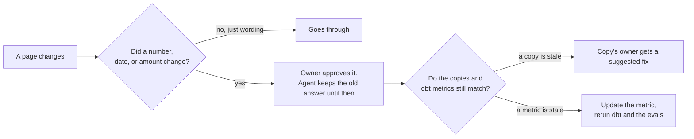

# Approved knowledge

If an AI agent answers people's questions, it should only say things the people who own that information have signed off on. And when someone changes a page, I want to know whether the change actually matters before I bother anyone about it.

This folder tries that out with the definitions behind my bike data, like what counts as "near" a new bike lane.

## How it's set up

- Each folder in `sources/` belongs to one owner: `nyc-safety`, `boston-counts`, `bluebikes`, and `public-site` (a FAQ). In a real organization these would be offices.
- Each `## ` section of a page is one concept, with a `term:` line that matches [`glossary.yml`](glossary.yml).
- The glossary says who owns each concept. The owner's section is the definition. If another page mentions the same concept, it's a copy.
- [`approved.yml`](approved.yml) is what each owner approved. The agent only answers from the owners' approved sections.

## What happens when a page changes



The check saves a hash of each approved section and pulls out its facts: numbers with units, dollar amounts, months, and years. If the text changes but the facts don't, it's just rewording, and nobody needs to look at it. If a fact changes, the owner has to approve it first.

I don't rewrite a copy on someone else's page, because that page is theirs. The check suggests a fix that swaps the copied number for a reference, like `{{ near_new_lane: meters }}`. That gets filled in from the approved definition, so once the owner accepts the fix, their page keeps up on its own.

The dbt metrics list the concepts they depend on in `config.meta.glossary_terms` (in [`_semantic.yml`](../dbt/models/marts/_semantic.yml)). So when a definition changes, the check also tells me which metrics to update.

## Try it

```bash
uv run bikelake-knowledge check             # exits 1 if a person needs to look at something
uv run bikelake-knowledge ask near_new_lane # what the agent would say
uv run bikelake-knowledge demo              # walks through a change, in a temporary copy
```

The demo changes "near" from 50 meters to 75:

1. nyc-safety rewords its page. The facts are the same, so it goes through.
2. nyc-safety changes 50 to 75. The check asks nyc-safety, and the agent still says 50.
3. nyc-safety approves. The agent says 75. The FAQ still says 50, so public-site gets a suggested fix, and the check also flags the `new_lane_injury_change` metric, whose description says 50.
4. public-site accepts the fix, and the metric is updated. Everything passes.
5. nyc-safety changes it again, to 60. The FAQ shows 60 without anyone touching it.

The same check runs in a [GitHub Action](../.github/workflows/knowledge.yml) whenever a page or a metric changes.

## What it doesn't do

- It finds facts by pattern, so it misses facts written out in words, like "half a block" or "fifty meters." A language model could pull out facts instead, but that costs money on every change.
- It only compares sections tagged with the same concept. A page that repeats a definition without the tag gets missed. Embedding search could help find those.
- It checks what a metric's description says, not its SQL. The real lane query uses a 0.0005-degree buffer ([the model](../dbt/models/intermediate/int_nyc__cyclist_crashes_near_new_lanes.sql)), and changing to 75 meters would mean changing that too.
- Approving is a command here. In a real setup, the owner would approve a pull request, with a CODEOWNERS entry for each owner's folder.
